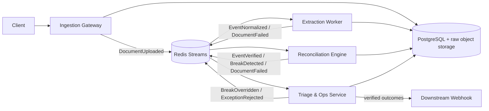

# Service Design Index

Status: Proposed design baseline; approve contracts before implementation.

These designs decompose the [product plan](../PROJECT_PLAN.md) into independently reviewable service boundaries. They describe the MVP shape, not implemented behavior. The four services communicate through versioned events and explicit HTTP APIs; they do not import one another's implementation.

## Service map

## Designs

- [Shared contracts and event flow](SHARED_CONTRACTS.md)
- [Ingestion Gateway](INGESTION_GATEWAY.md)
- [Extraction Worker](EXTRACTION_WORKER.md)
- [Reconciliation Engine](RECONCILIATION_ENGINE.md)
- [Triage and Ops Service](TRIAGE_OPS.md)

## Review and implementation gate

Before implementation, review the event/state semantics, tenant access model, severity/role matrix, evidence retention, currency tolerance, and exact provider interface. The service docs should be approved together because the shared event and persisted record boundaries cross all four services.

For each service story, Ready means the relevant design section, API/event contract, data ownership, security controls, failure handling, and acceptance criteria are agreed. Changes to a pinned contract require a versioned update and compatibility/replay plan.
